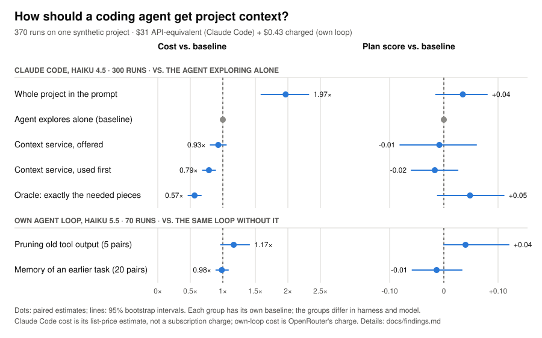

# Context Orchestrator

Does a coding agent work more cheaply if it **asks for the project context it
needs** instead of exploring the files itself, or being handed everything?
This repository holds a small context service built to test that, the
benchmark harness, and every raw result.

## TL;DR

- **The question:** coding agents burn most of their tokens re-reading
  project context. Can a shared context service, plus ideas like pruning
  and memory, cut that cost without hurting the work?
- **What we did:** 460 agent runs on a synthetic ~140k-token project with 20
  graded tasks: 300 in Claude Code (Haiku 4.5), and 160 in our own agent loop
  (Haiku 5.5, $0.91 actually charged), each test planned before it ran.
- **What worked:**
  - asking the context service first: **~21% cheaper** (just offering it
    didn't help: agents often skipped it);
  - running the model at **low effort** (less thinking): **29% cheaper**,
    cheaper in 10 of 10 pairs, no quality loss;
  - memory from earlier tasks, **reviewed and trusted**: **18% cheaper**,
    with a small, possibly noisy, quality dip.
- **What didn't:** the whole project in the prompt **doubled** the cost.
  **Pruning** old tool output, the in-place editing idea behind Meta's
  *Context Language Models* and the Claude API's context editing, looked like
  a 33–53% saving in replays but cost **17% more** when run on a newer
  model. **Unreviewed memory** saved nothing, and outline-first file reads
  were inconclusive.
- **The lesson:** agents re-read what they're given unless they're allowed
  to trust it, so the bottleneck is trust, not retrieval. And measure,
  don't extrapolate: savings estimated from one model's recordings didn't
  survive a newer model.

<picture>
  <source media="(prefers-color-scheme: dark)" srcset="docs/img/results-dark.svg">
  
</picture>

## What we tested

- **A synthetic project.** "Hallpass" is a fictional council booking system:
  ~140k tokens of code, tests, SQL migrations, design decisions and known
  bugs, with outdated and superseded documents deliberately mixed in.
- **20 realistic tasks**, each with a grading rubric written before any run.
- **Five ways of giving a coding agent context** (Claude Code, Haiku 4.5):
  - the whole project in the prompt;
  - letting the agent explore the files alone;
  - our context service as a tool, merely offered;
  - the same service, with the agent told to use it first;
  - an "oracle" holding exactly the needed pieces.
- **The main benchmark:** 300 runs (20 tasks × 5 strategies × 3), compared
  per task with 95% confidence intervals.
- **Smaller follow-up checks** (10 runs each): compact excerpts, "trust the
  excerpts" instructions, and a sub-agent that does all the reading.
- **Replays of the recordings** to see where the tokens actually go.
- **Five cost levers in our own agent loop** (Haiku 5.5 via OpenRouter, 160
  runs, $0.91 actually charged):
  - **pruning**: removing old tool output from the agent's context as it
    works;
  - **memory across tasks**: agents save findings, each anchored to the file
    lines that prove it, so a later task in the same area starts ahead;
    tested unreviewed, and reviewed with agents told to trust it;
  - **outline-first file reads**: long files show an outline first;
  - **low effort**: less thinking per step.

## What we found

- **The context service cut cost by about a fifth** (0.79×) with no
  detectable change in plan quality, **but only when the agent was told to use
  it.** Merely offered, it was skipped in 18 of 60 runs and the saving
  disappeared into noise.
- **Putting the whole project in the prompt doubled the cost** for, at most,
  a small quality gain. The project is re-sent on every turn.
- **Pruning old tool output didn't save money** (cost ×1.17 over 5 pairs),
  although replaying the Claude Code recordings had estimated −33% to −53%.
  Haiku 5.5 works in few, wide steps, so little old output is re-sent;
  pruned agents went back to re-read what was removed; and every edit forces
  part of the cached context to be written again.
- **Unreviewed memory across tasks didn't save money** (cost ×0.98, 95%
  interval 0.90–1.09, over 20 pairs). The findings were accurate and reached
  the next agent, but it **opened 30 of the 36 files they cited anyway**.
- **Reviewed memory that agents may trust did** (cost ×0.82, 0.74–0.92, 20
  pairs). Told that verified findings were checked against their lines,
  agents re-opened 35% of the cited files instead of 59%. Plans missed
  slightly more rubric points (score −0.035), within the margin set in
  advance. The findings were reviewed by Claude, not by a person.
- **Low effort cut cost by 29%** (×0.71, 0.65–0.77; 10 of 10 pairs) with no
  quality loss: about two-thirds less thinking, and fewer, smaller steps.
- **Outline-first file reads were inconclusive** (×0.91, 0.83–1.00): Haiku
  5.5 rarely reads long files whole anyway.
- **Agents re-read what they've already been given.** With the service, 35%
  of what they read had already been served; with memory, most cited files
  were opened again. Better search scores and good findings didn't change
  that.
- **A sub-agent doing all the reading was worse:** more tokens on every task,
  lower quality. Each call starts from scratch, and its summaries lose detail.
- **Single runs are noisy** (about ×1.7 in tokens). Small checks can only
  detect large effects.

## What we think

- **Asking for context helps, when the agent actually asks.** The one clear
  saving came from the service used first; offering it was not enough.
- **Estimates from recordings don't transfer across models.** The biggest
  saving on paper (pruning) vanished on a newer model that works
  differently. Measure before building on a replay.
- **The bottleneck is trust, not retrieval.** Agents verify what they're
  handed by reading the source again. Unreviewed memory saved nothing; the
  same findings, reviewed and trusted, saved 18%. A memory is only worth
  what its review process makes it worth, and trusting it trades a little
  thoroughness for cost.
- **Look at where the money goes before optimising.** On Haiku 5.5, 46% of
  cost was writing new context to the cache and 38% was output. Pruning old
  context targeted the remaining 16%, which is why it couldn't pay; turning
  down thinking targeted output and gave the biggest saving.
- **The evidence is narrow:** one synthetic project, two small models,
  rubric-graded plans rather than executed code, and small samples for the
  newer checks. Claude Code figures are list-price estimates, not
  subscription charges. Treat the numbers as careful first measurements.

The full write-up is in [docs/findings.md](docs/findings.md); every run with
its caveats is in [benchmarks/README.md](benchmarks/README.md).

## Try it

Python 3.11+, no runtime dependencies. Optional meaning-based search uses a
local [Ollama](https://ollama.com) with `nomic-embed-text`.

```bash
git clone https://github.com/bn-basel/context-orchestrator.git
cd context-orchestrator
uv sync
uv run ctxo ingest examples/sample_project
uv run ctxo request examples/sample_project --task "Why are fines capped?" --kind decision --kind code --format markdown
```

To use it from Claude Code, run it as an MCP tool:

```json
{"mcpServers": {"ctxo": {"command": "uv", "args": ["run", "--directory", "path/to/context-orchestrator", "ctxo", "mcp", "path/to/project"]}}}
```

Every answer contains verbatim excerpts with file paths and line ranges,
trust labels (verified, observed, assumption), and a list of what it could
not find.

## Reproduce

```bash
uv run pytest
uv run ctxo eval-retrieval benchmarks/tasks/hallpass.json
uv run ctxo eval-agent benchmarks/tasks/hallpass.json --rubrics benchmarks/tasks/hallpass.rubrics.json --tasks H01 --strategies B2,C --service-args "--retrieval bm25 --hops 2"
uv run ctxo analyze-agent benchmarks/results/<run>
uv sync --group loop
uv run ctxo loop-eval prune benchmarks/tasks/hallpass.json --rubrics benchmarks/tasks/hallpass.rubrics.json --arms L,LP --tasks H17,H13,H11,H19,H09
uv run python benchmarks/memory_analysis.py benchmarks/results/<memory-run>
uv run python benchmarks/charts/results_chart.py
```

`eval-retrieval` makes no model calls. `eval-agent` runs Claude Code and uses
real usage, so start small. The published Claude Code runs used
`--model haiku` (then Haiku 4.5) and `--retrieval hybrid` (needs Ollama);
`bm25` works without it. `loop-eval` calls Claude Haiku 5.5 through
OpenRouter with the key in a git-ignored `.env` (see `.env.example`), stops
itself at an estimated $2, and records OpenRouter's charge per call. Method:
[docs/benchmark-methodology.md](docs/benchmark-methodology.md). Design:
[docs/architecture.md](docs/architecture.md). Plans: [ROADMAP.md](ROADMAP.md).

## License

[MIT](LICENSE).
