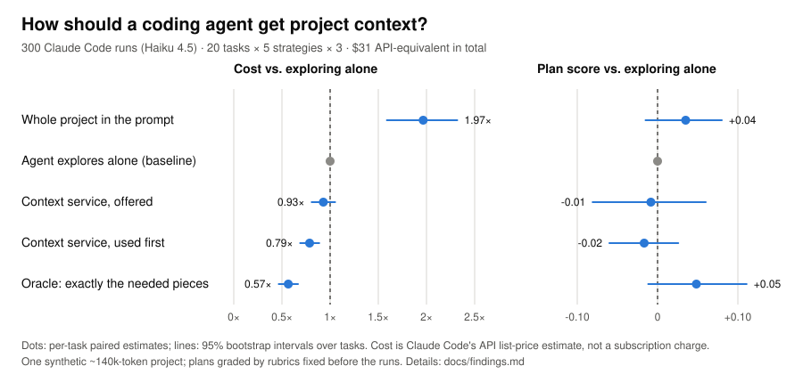

# Context Orchestrator

Does a coding agent work more cheaply if it **asks for the project context it
needs** instead of exploring the files itself, or being handed everything?
This repository holds a small context service built to test that, the
benchmark harness, and every raw result.

<picture>
  <source media="(prefers-color-scheme: dark)" srcset="docs/img/phase2-results-dark.svg">
  
</picture>

## What we tested

- **A synthetic project.** "Hallpass" is a fictional council booking system:
  ~140k tokens of code, tests, SQL migrations, design decisions and known
  bugs, with outdated and superseded documents deliberately mixed in.
- **20 realistic tasks**, each with a grading rubric written before any run.
- **Five ways of giving a coding agent context** (Claude Code, Haiku 4.5):
  - the whole project in the prompt;
  - letting the agent explore the files alone;
  - our context service as a tool, merely offered;
  - the same service, with the agent told to use it first;
  - an "oracle" holding exactly the needed pieces.
- **The main benchmark:** 300 runs (20 tasks × 5 strategies × 3), compared
  per task with 95% confidence intervals.
- **Smaller follow-up checks** (10 runs each): compact excerpts, "trust the
  excerpts" instructions, and a sub-agent that does all the reading.
- **Replays of the recordings** to see where the tokens actually go.

## What we found

- **The context service cut cost by about a fifth** (0.79×) with no
  detectable change in plan quality, **but only when the agent was told to use
  it.** Merely offered, it was skipped in 18 of 60 runs and the saving
  disappeared into noise.
- **Putting the whole project in the prompt doubled the cost** for, at most,
  a small quality gain. The project is re-sent on every turn.
- **Most of the input cost is old tool output** (files the agent read earlier)
  being re-sent with every later step. Replaying the recordings suggests that
  pruning it in place could cut input tokens by a third to a half. That is
  untested so far.
- **Better search scores didn't automatically mean cheaper agents.** Compact
  excerpts pointed to more of the right places, but the agent then opened
  those files itself, so cost stayed the same.
- **A sub-agent doing all the reading was worse:** more tokens on every task,
  lower quality. Each call starts from scratch, and its summaries lose detail.
- **Single runs are noisy** (about ×1.7 in tokens). Small checks can only
  detect large effects.

## What we think

- **Retrieval helps, but the bigger lever is what stays in the agent's
  context.** The next experiment is editing the context in place (removing
  stale tool output), the idea behind Meta's Context Language Models and the
  Claude API's context editing. Summarising context instead loses the
  details agents need.
- **How the agent is told to use a tool matters as much as the tool.**
- **The service was designed for memory across tasks**: agents saving
  verified findings so the next task starts ahead. A single-task benchmark
  cannot show that; it is the obvious next benchmark.
- **The evidence is narrow:** one synthetic project, one small model,
  rubric-graded plans rather than executed code, and API-equivalent costs
  (the CLI's list-price estimates, not subscription charges). Treat the
  numbers as a careful first measurement.

The full write-up is in [docs/findings.md](docs/findings.md); every run with
its caveats is in [benchmarks/README.md](benchmarks/README.md).

## Try it

Python 3.11+, no runtime dependencies. Optional meaning-based search uses a
local [Ollama](https://ollama.com) with `nomic-embed-text`.

```bash
git clone https://github.com/bn-basel/context-orchestrator.git
cd context-orchestrator
uv sync
uv run ctxo ingest examples/sample_project
uv run ctxo request examples/sample_project --task "Why are fines capped?" --kind decision --kind code --format markdown
```

To use it from Claude Code, run it as an MCP tool:

```json
{"mcpServers": {"ctxo": {"command": "uv", "args": ["run", "--directory", "path/to/context-orchestrator", "ctxo", "mcp", "path/to/project"]}}}
```

Every answer contains verbatim excerpts with file paths and line ranges,
trust labels (verified, observed, assumption), and a list of what it could
not find.

## Reproduce

```bash
uv run pytest
uv run ctxo eval-retrieval benchmarks/tasks/hallpass.json
uv run ctxo eval-agent benchmarks/tasks/hallpass.json --rubrics benchmarks/tasks/hallpass.rubrics.json --tasks H01 --strategies B2,C
uv run ctxo analyze-agent benchmarks/results/<run>
uv run python benchmarks/charts/phase2_chart.py benchmarks/results/20261011T032628Z-hallpass-agent
```

`eval-retrieval` makes no model calls. `eval-agent` runs Claude Code and uses
real usage, so start small. Method:
[docs/benchmark-methodology.md](docs/benchmark-methodology.md). Design:
[docs/architecture.md](docs/architecture.md). Plans: [ROADMAP.md](ROADMAP.md).

## License

[MIT](LICENSE). Built by bn-basel with Claude (Anthropic) as co-author.
